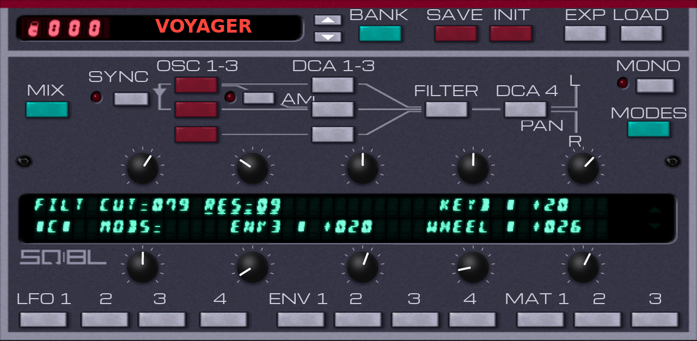

# SQ8LMPC 0.2.0



**Port of SQ8L 0.91b (Ensoniq SQ-80 emulation by Siegfried Kullmann) to the Akai Force and MPC (MPC OS 3.x, ARMv7 VST2
through [mpc-vst-plugins](https://github.com/sd88me/mpc-vst-plugins)). Based on
[sq8l-revival](https://github.com/sq8l-revival/SQ8L). Unofficial, free, non-commercial, for preservation only.**

> [!IMPORTANT]
> **This is not made by, or endorsed by, Siegfried Kullmann, Ensoniq, Creative Labs (who own the Ensoniq brand), sq8l-revival or Akai Professional.** The sound
> engine, the panel artwork and the factory bank C are the work of **Siegfried Kullmann** (SQ8L, © 2006-2008). The
> SQ-80 wave ROM and the SQ-80 factory sounds (bank D) are **Ensoniq**'s and are **not included**: you bring your own,
> legally obtained copies (see [Bring your own ROM](#bring-your-own-rom)). This repository grants no licence on
> Kullmann's material; it is published free of charge, for preservation only, in good faith. If you hold rights and
> object, open an issue and ask for a private contact: it will be removed. See [Credits](#credits) and
> [LICENSES.md](LICENSES.md).

**Status: tested on an Akai Force (MPC OS 3.9.1, 2026-11-16).** Downloads:
[Releases](https://github.com/sunskiefer/SQ8LMPC/releases). Tell us how it runs under Issues.

## What it is

SQ8L is a faithful emulation of the Ensoniq SQ-80 (the sound of its three oscillators, filter, envelopes, LFOs and
modulation matrix). SQ8LMPC runs the same engine on the Force. The sound is the same engine and the same sounds; the
panel is the SQ8L panel, drawn large for the Force's touchscreen, on **one screen**.

- **128 factory sounds built in:** bank C (SQ8L's own). Bank D is for the SQ-80 factory sounds, which you bring
  yourself (below). Banks A and B are yours (writable). 512 slots in all.
- **Save your own:** SAVE writes the current sound to banks A and B and keeps the whole set in `data/User/` on the
  device. Banks C and D are factory and refuse to be overwritten.
- **Drop-in banks:** put `.8XL`, `.syx`, `.dat`, `.bnk` or `.8XB` files in `data/Banks/`, then press LOAD to step
  through them. EXP writes the selected sound as a `.syx` to `data/Export/`.
- **8 voices**, as the original.
- **Q-Links:** two pages, PANEL 1 (the ten knobs) and PANEL 2 (the other controls). The data wheel works on the
  selected parameter.
- **Everything is placed in one file:** `layout.json` (id, x, y, w, h for every control and every label). Move
  anything with the [Panel Editor](editor/SQ8LMPC-panel-editor.html), export, rebuild.

See the [user guide](docs/USER_GUIDE.md).

## Install

Unzip `SQ8LMPC-0.2.0-mpc-armv7.zip`, copy the folder to the Force, run `install.sh` on the device (as root);
`uninstall.sh` removes it. Your saved sounds stay in `data/User/` on upgrade. MPC OS 3.x only.

## Bring your own ROM

The plugin ships **without** the SQ-80 wave ROM and without the SQ-80 factory sounds; both are Ensoniq's.

- **Wave ROM:** put your own, legally obtained copy in `data/ROM/SQ80.ROM` inside the plugin folder on the device
  (`/sdcard/Synths/L'Cronx - VST - SQ8LMPC/data/ROM/`). It is the raw wave ROM image, exactly 262,144 bytes. The
  release's `mpc-plugin.json` describes it (`user_files`), so a plugin manager that reads the catalog can check and
  copy it for you. Without it the plugin loads, the display says `NO ROM`, and it stays silent. Reload the plugin after
  copying the file.
- **Bank D (the 40 SQ-80 factory sounds):** drop your copy into `data/Banks/` (`.syx` SQ-80 bank dump, or an SQ8L
  bank file) and press LOAD, like any other bank.

This repository does not link to, and its issues will not point to, any source for these files.

## Testing

The engine is built for ARMv7 with the original's x87 rounding emulated, and its correctly rounded math (CORE-MATH)
matches the native build bit for bit. It is run under QEMU. Program select, pages, knobs, SAVE, reload and drop-in banks are exercised offline
(`tests/`). 0.2.0's audio with the ROM file is byte-identical to 0.1.0's (`tests/pcm.cpp`), and without it the output
is all zero (`tests/romcheck.cpp`). 0.2.0 has been run on an Akai Force (MPC OS 3.9.1, 2026-11-16); see `tested.json`.

## Building

```
./build.sh        # Python 3 with Pillow, NumPy and SciPy; Zig (pip install ziglang). No Docker.
```

Produces `build/package/L'Cronx - VST - SQ8LMPC/`. Release zip: `third_party/mpc-vst-plugins/tools/release.py`.

## Credits

- **Siegfried Kullmann**: SQ8L, © 2006-2008, the emulation, the panel and the factory sounds. The rights belong to him.
- **Ole Jeppesen** and Siegfried Kullmann: factory bank C. **Ensoniq**: the SQ-80 wave ROM and the SQ-80 factory
  sounds (bank D), neither of which is included.
- **sq8l-revival**: the 64-bit port of SQ8L 0.91b this is based on (github.com/sq8l-revival/SQ8L).
- **sd88me** and the mpc-vst-plugins contributors: the Force / MPC OS VST2 wrapper and tools (MIT).
- **CORE-MATH** (Inria): correctly rounded math (MIT). **Michroma**: the panel lettering (SIL OFL 1.1).
- Ensoniq, ESQ-1 and SQ-80 are trademarks of their respective owners.

## Licence

The code written for this Force / MPC port (the plugin glue, the skin and panel builder, the Panel Editor, the tests
and the build) is © 2026 L'Cronx, under the **PolyForm Noncommercial License 1.0.0** ([LICENSE](LICENSE)): free to use,
not for sale. **Everything else keeps its owner's terms**: nothing here relicenses SQ8L, Kullmann's or Ensoniq's
material, sq8l-revival, or any third-party code. [LICENSES.md](LICENSES.md) lists who owns what;
[THIRD_PARTY_NOTICES.md](THIRD_PARTY_NOTICES.md) has the notices.
